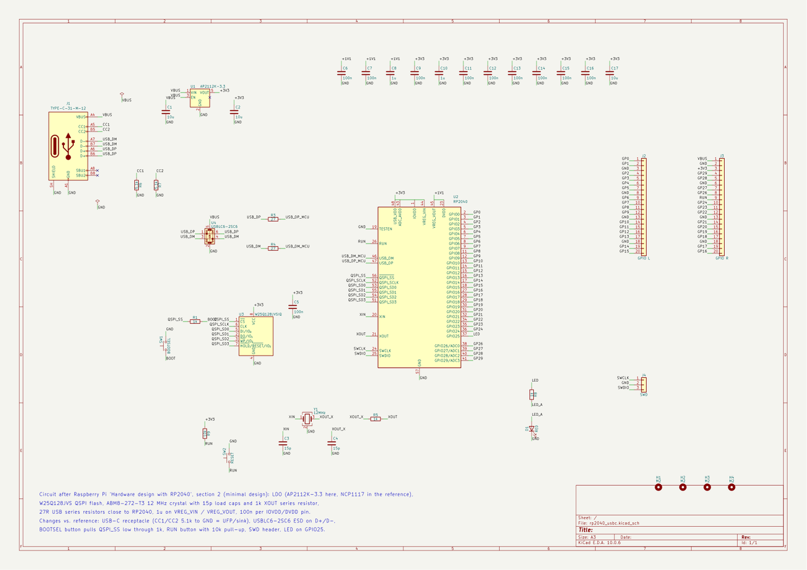
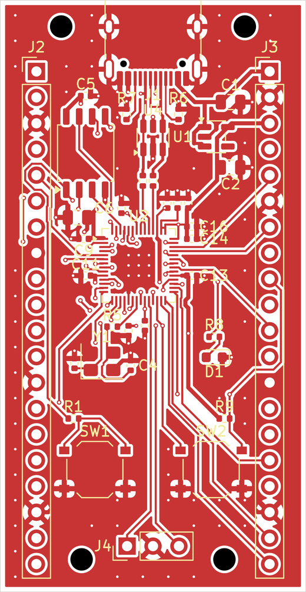
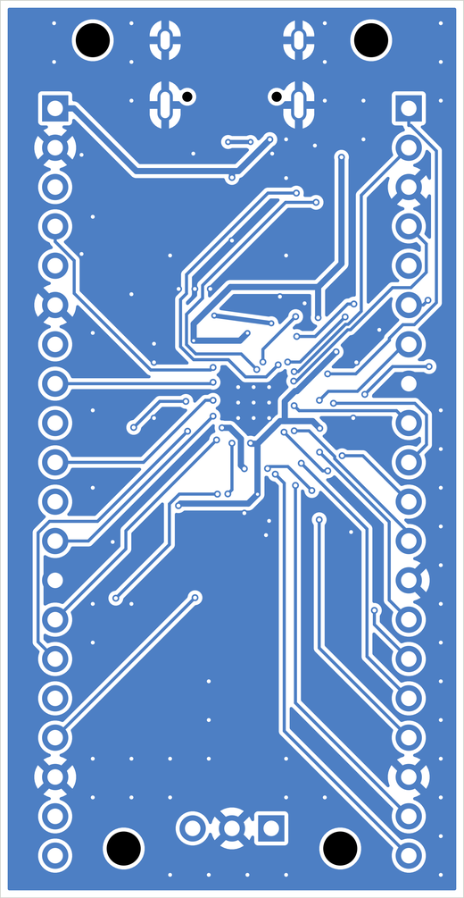
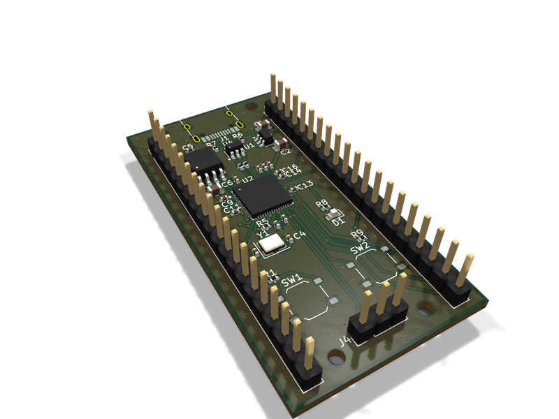
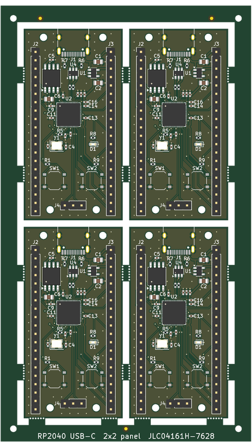

# RP2040 USB-C board, 4 layers, with a 2x2 production panel

Owner: Ha Phan Thanh Hai (GitHub `haiha-ux`). A small RP2040 development board in KiCad 10, laid out for the JLCPCB 4-layer stackup JLC04161H-7628, with fabrication and assembly files and a 2x2 panel. The board is 30 × 58 mm and has a USB-C device port, 16 MB QSPI flash, a 3.3 V LDO, BOOTSEL and RESET buttons, a 3-pin SWD header, a status LED on GPIO25 and two 1x20 headers that bring out GPIO0 to GPIO29.

The board has not been manufactured or tested. Everything below was checked with KiCad's ERC and DRC and with the scripts in `tools/`.

| Schematic | Top copper | Bottom copper |
|---|---|---|
|  |  |  |

| 3D view | 2x2 panel |
|---|---|
|  |  |

## Files

| Path | Content |
|---|---|
| `rp2040_usbc.kicad_sch`, `rp2040_usbc.kicad_pcb`, `rp2040_usbc.kicad_pro` | KiCad 10 project |
| `rp2040_usbc_schematic.pdf` | schematic |
| `fab/gerber/`, `fab/rp2040_usbc-gerber.zip` | Gerber X2 for 4 copper layers, mask, paste, silk, outline; Excellon drill (PTH and NPTH separate) |
| `fab/rp2040_usbc-BOM.csv` | BOM with manufacturer, MPN and LCSC part number for every line |
| `fab/rp2040_usbc-CPL.csv` | pick-and-place file with JLC column names |
| `panel/rp2040_usbc_panel.kicad_pcb`, `panel/rp2040_usbc_panel-gerber.zip` | 2x2 panel and its Gerber/drill set |
| `reports/` | ERC and DRC reports for the board, DRC for the panel, measured fab minimums |
| `tools/` | the scripts that built and checked all of the above |

## Circuit

The circuit follows the minimal design in section 2 of Raspberry Pi's "Hardware design with RP2040": W25Q128JVS QSPI flash, ABM8-272-T3 12 MHz crystal with 15 pF load capacitors and a 1 kΩ series resistor on XOUT, 27 Ω series resistors on USB D+ and D- close to the chip, 1 µF on VREG_VIN and VREG_VOUT and 100 nF on each IOVDD and DVDD pin. RUN has no internal pull-up on the RP2040, so it gets 10 kΩ to 3.3 V and the RESET button pulls it low. BOOTSEL pulls QSPI_SS low through 1 kΩ.

Some parts differ from the reference. The regulator is an AP2112K-3.3 in SOT-23-5 instead of the NCP1117, which keeps it clear of the header rows. USB uses a USB-C receptacle wired as a sink, with 5.1 kΩ from each CC pin to ground, and both D+/D- pin pairs of the receptacle are joined so the plug works either way round. A USBLC6-2SC6 protects D+, D- and VBUS. The RP2040 is a USB Full-Speed device (12 Mbit/s).

ERC reports 0 errors and 0 warnings. `tools/check_netlist.py` exports the netlist with kicad-cli and compares all 54 designed nets pin by pin with the net table in `tools/design.py`. It matches completely, and the script also checks itself by moving one pin and confirming that the comparison then fails.

## Stackup and USB impedance

The stackup is JLC04161H-7628 from the JLCPCB impedance page (https://jlcpcb.com/impedance): 35 µm outer copper, 0.2104 mm of 7628 prepreg (Er 4.4) to the first inner layer, a 1.065 mm core and 15.2 µm inner copper. The layers are used as signals and ground pour on F.Cu, a solid ground plane on In1, a 3.3 V pour on In2, and signals and ground pour on B.Cu. The USB pair on F.Cu therefore runs over an unbroken ground plane on In1.

For 90 Ω differential impedance the pair is 0.27 mm wide with a 0.15 mm gap. `tools/usb_impedance.py` computes this with the Hammerstad-Jensen microstrip model (scikit-rf) and the IPC-2141 coupling term. The two single-ended models agree within 2 %, and the result is 90.0 Ω. The tracks neck down to 0.20 mm only at the last fraction of a millimetre into the pads of the 0402 resistors and the QFN.

The USB lines are routed by hand in `tools/build_pcb.py`, from the receptacle through the ESD diode and the 27 Ω resistors to pins 46 and 47. D+ is 17.6 mm long and D- is 18.1 mm. The 0.5 mm difference is far below anything that matters at Full Speed. D+ uses two vias to join the receptacle's second D+ pin from underneath, and D- needs none.

## Layout and routing

Placement and the critical routing are done in Python with KiCad's pcbnew API. The decoupling capacitors sit next to their supply pins as in figure 6 of the Raspberry Pi guide, with the 1.1 V and 3.3 V pins fanned out by hand. The remaining signals were routed by Freerouting 2.4.1, with the USB pair and the hand-made fanout locked so the router could not move them. After routing the script adds ground stitching vias on a 2.5 mm grid wherever they keep 0.5 mm from other copper, then fills the pours. The board has 146 vias, all 0.40 mm with a 0.20 mm drill.

DRC with schematic parity reports 0 errors, 0 unconnected pads and 0 parity problems. Two warnings remain, both for the USB-C receptacle's silkscreen at the board edge. The receptacle is meant to sit flush with the edge, so I left them.

The references of 10 small parts (C3, C7, C8, C10, C12, C15, C17, R3, R4 and U3) did not fit on the silkscreen at JLCPCB's minimum text size of 1.0 mm without touching pads, so they are on the F.Fab layer. They still appear in the assembly drawing and in the CPL file.

## Panel

`tools/panelize.py` builds a 2x2 panel of 76 × 132 mm. The boards are separated by 2 mm routed slots and surrounded by 5 mm rails. Each rail corner has a 2 mm tooling hole, and there are three 1 mm fiducials, all centred 3.85 mm from the panel edge as JLCPCB asks. The boards hang on 5 mm breakaway tabs with mouse bites, which are six 0.5 mm holes at 0.8 mm pitch (0.3 mm of material between holes). Each board has two tabs on each long side, and the bottom row also has two tabs to the bottom rail.

There are no tabs on the top edge of a board, because that edge carries the USB-C receptacle and two M2 mounting holes. A tab there would put mouse-bite holes inside the mounting hole courtyards, and a broken tab would leave a rough edge next to the connector. The receptacle body reaches 0.05 mm past the board edge and its courtyard 0.53 mm, so it stays inside the 2 mm slot.

The four copies share net names, so the panel DRC also lists every net as unconnected between copies. `tools/check_panel.py` separates these. It finds 0 unconnected items inside any one board, and 171 links between copies, which is 57 nets × 3. The only violations are the same USB-C silkscreen warnings, 8 in total.

## DFM check against JLCPCB capabilities

The board values come from `tools/dfm_measure.py` (`reports/dfm_measure.json`). The limits are from https://jlcpcb.com/capabilities/pcb-capabilities.

| Item | This design | JLCPCB limit |
|---|---|---|
| Track width (multilayer) | 0.15 mm minimum, 0.27 mm USB | 0.09 mm |
| Copper clearance | 0.15 mm rule | 0.09 mm |
| Via | 0.40 mm pad, 0.20 mm drill | 0.25 mm pad, 0.15 mm drill |
| Hole to hole | 0.36 mm minimum | 0.2 mm |
| Copper to routed edge | 0.5 mm rule, nearest track 1.73 mm | 0.2 mm |
| Solder mask between QFN pads | 0.2 mm (0.4 mm pitch, 0.2 mm pads, no expansion) | 0.1 mm |
| Silkscreen text | 1.0 mm high, 0.15 mm stroke | 1.0 mm, 0.15 mm |
| Panel rails, tooling holes, fiducials | 5 mm, 2 mm, 1 mm at 3.85 mm | 5 mm, 2 mm, 1 mm at 3.85 mm |
| Breakaway tab | 5 mm wide | 5 mm or more with mouse bites |
| Mouse bites | 0.5 mm holes, 0.3 mm apart | 0.5 to 0.8 mm holes, 0.2 to 0.3 mm apart |

## Limitations

- The 90 Ω figure comes from closed-form formulas, which are good to roughly ±10 %. I did not run a field solver. For a controlled-impedance order, the trace width should be confirmed with JLCPCB's own calculator, or the impedance control option selected so the fab adjusts it.
- The pair is not coupled for its whole length. It splits at the receptacle's two pin rows, at the ESD diode and at the series resistors. That is acceptable for Full-Speed USB but would not be for High-Speed.
- The CPL rotations are KiCad's. JLCPCB often needs some parts (QFN, SOT-23, the USB-C receptacle) rotated in its placement preview, so check them there before ordering assembly.
- Freerouting does not give the same result twice. `build_pcb.py` repeats the routing until DRC is clean, so a rebuild gives a valid board but not necessarily the same track shapes.
- The panel uses mouse-bite tabs only. I did not evaluate a V-score version, which would leave cleaner edges but needs straight cuts across the whole panel and copper kept at least 0.4 mm from each cut.

## Rebuild

```bash
python tools/build_schematic.py                       # schematic through Konnect (KONNECT_EXE)
python tools/check_netlist.py
"<KiCad>/bin/python.exe" tools/build_pcb.py clean     # placement, USB + fanout, Freerouting (JAVA, FREEROUTING_JAR)
"<KiCad>/bin/python.exe" tools/build_pcb.py silk
"<KiCad>/bin/python.exe" tools/panelize.py
"<KiCad>/bin/python.exe" tools/check_panel.py
"<KiCad>/bin/python.exe" tools/dfm_measure.py
bash tools/export_outputs.sh                          # reports, Gerber, drill, BOM, CPL, renders, panel Gerber
```

Requires KiCad 10, Python 3.11 with scikit-rf, PyMuPDF and cairosvg, Freerouting 2.4.1 on Java 21 or newer, and the Konnect KiCad plugin for the schematic step.
